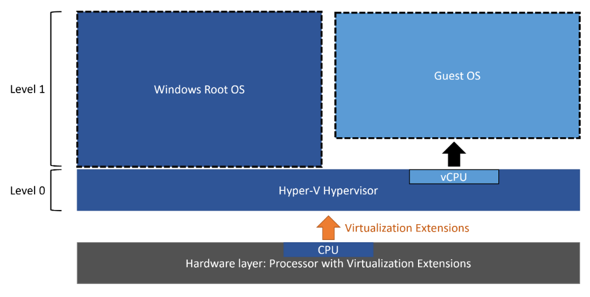
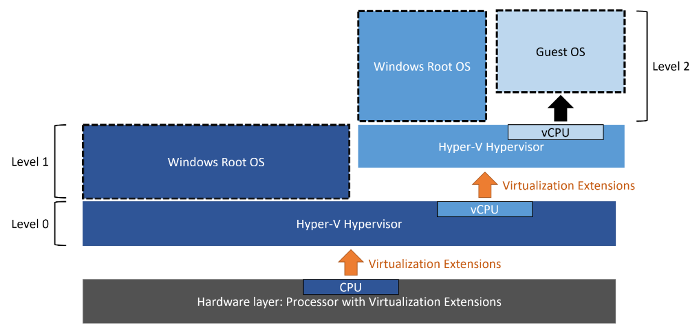
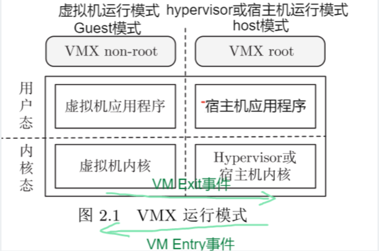
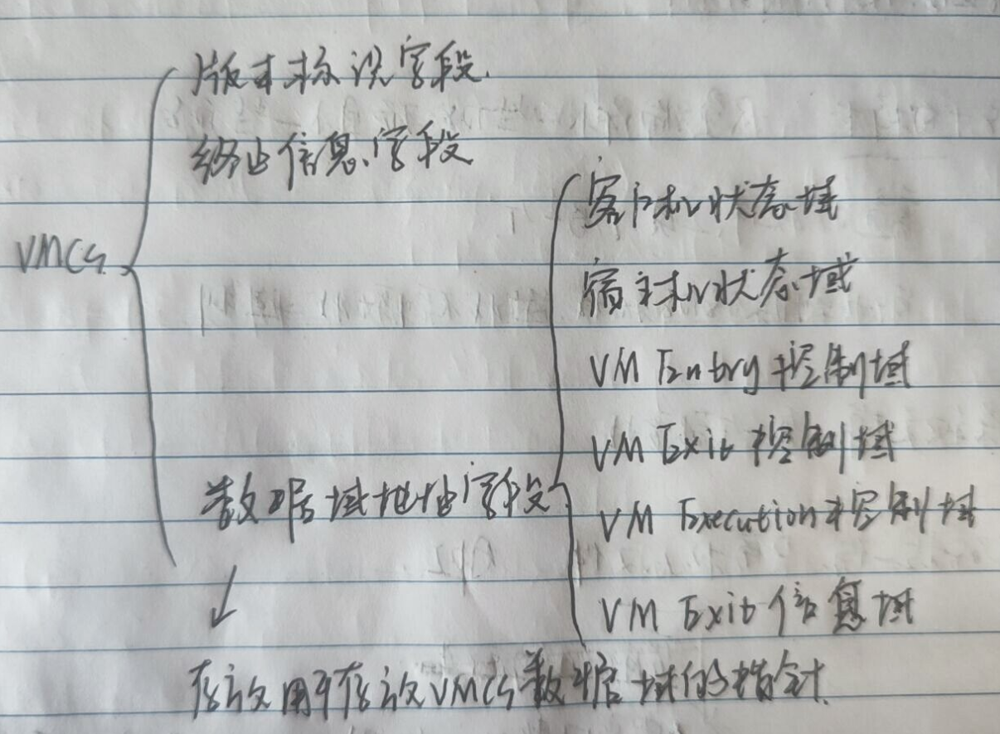
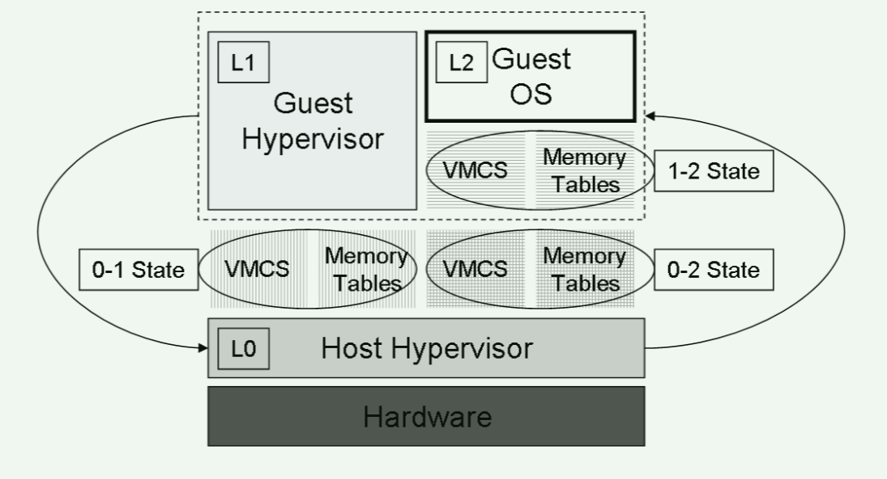
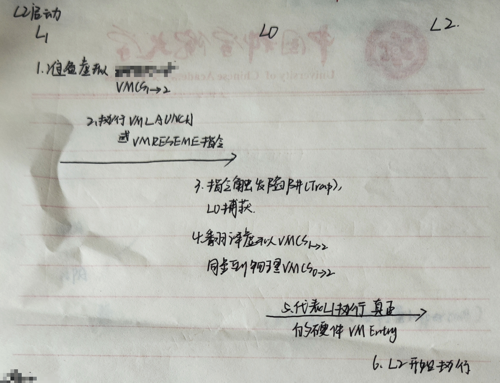
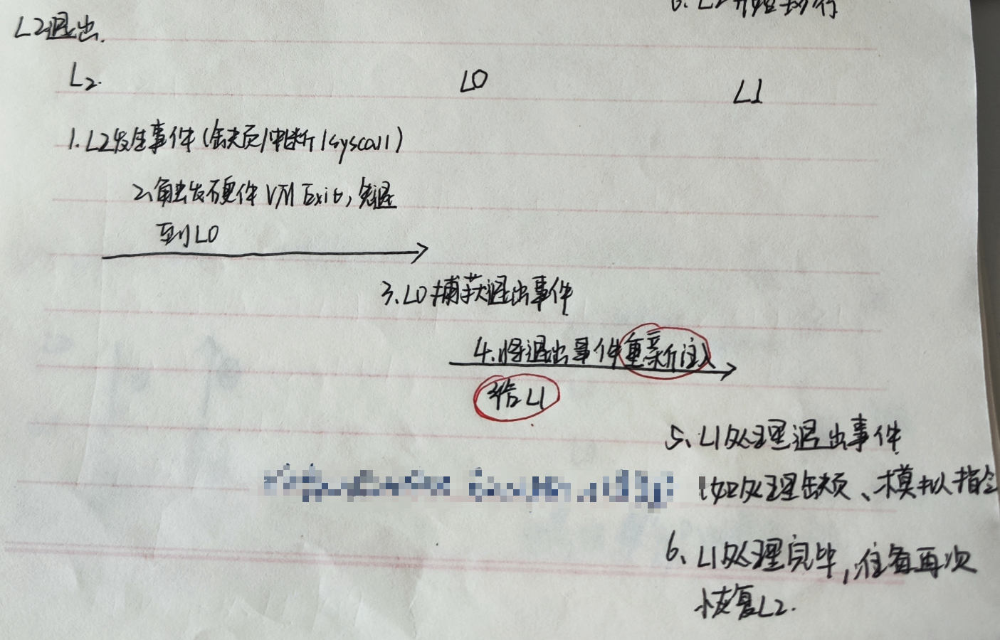
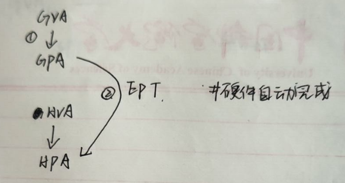
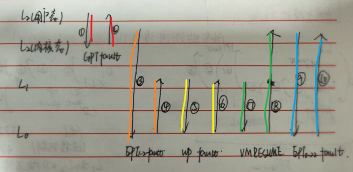

# 嵌套虚拟化

> 基于Intel x86 架构，基于KVM hypervisor

## 嵌套虚拟化定义：

在经典（传统）机器虚拟化中，一个 Hypervisor 同时运行多个操作系统，每个操作系统都运行在自己的虚拟机中。

在嵌套虚拟化中，一个 Hypervisor 可以运行多个其他 Hypervisor，以及它们所关联的虚拟机。

## 两种嵌套虚拟化模型：

- 多级架构支持（multi-level architectural support for nested virtualization）：每层 Hypervisor 处理自己上层客户机的敏感指令陷入，如 IBM System z。
- 单级架构支持（single-level architectural support for nested virtualization）：硬件只有一种 Hypervisor 模式，任何层次的陷入都回到最底层 Hypervisor 处理，如 Intel VMX 和 AMD SVM。

------

接下来讨论的对象都为单极架构支持

L0 为裸机 Hypervisor，L1 为 Guest Hypervisor，L2 为嵌套虚拟机。L0 通过模拟 VMX 指令，让 L1 以为自己能直接使用硬件。L1 再以类似方式模拟 VMX 给 L2。这种模拟可以递归工作。

由于实际能使用VMX指令的是 L0，所以任何层次的陷入都最终由 L0 处理、转发。

## CPU 虚拟化

### Intel VT-x（VMX）简要介绍

**VMX 的两种运行模式**：L0 运行在 VMX root 模式，L1 运行在 VMX non-root

**虚拟机控制结构（virtual machine control structures, VMCS）**：负责维护 VCPU 相关的数据结构与状态信息

> VMX 指令集和 VMCS 分布的详细信息：[Intel® 64 和 IA-32 架构手册](https://www.intel.com/content/www/us/en/developer/articles/technical/intel-sdm.html)

### 嵌套虚拟化

**VMX 两种运行模式**：L0 运行在 VMX root 模式，L1 和 L2 运行在 VMX non-root，但是 L1 以为自己运行在 VMX root 模式。L2 运行在客户端模式。

**VMCS**：

VMCS0->1：以 L0 的视角 L1 的环境，是 L0 用于运行 L1 的

VMCS1->2：以 L1 的视角 L2 的环境

VMCS0->2：以 L0 的视角 L2 的环境，是 L0 用于运行 L2 的

> L0 结合 VMCS0->1 和 VMCS1->2 创造了 VMCS0->2

**L2 启动**：（1）L1 准备运行 L2 的规范（VMCS1->2）；（2）L1 使用 VMX 指令（VMRESUME/VMLAUNCH）启动 L2；（3）由于 VMX 指令只能在 root 模式下运行，所以会陷入 L0，由 L0 模拟执行；（4）L0 需要先将 VMCS1->2 翻译为 L0 可以直接使用启动 L2 的规范（VMCS0->2），即 VMCS1->2 和 VMCS0->2 同步；（5）L0 启动 L2。

执行路径：L1 -> L0 -> L2

> L1 执行其它 VMX 指令（不是 VMRESUME/VMLAUNCH 这种运行一个新的 VM 的指令），L1 执行的时候先陷入 L0，由 L0 模拟执行，执行之后由 L0 进入 L1。
>
> 执行路径：L1 -> L0 -> L1

**L2 退出**：（1）L2 发生事件；（2）触发硬件 VM Exit；（3）L0 捕获退出事件，判断由自己处理还是转发给 L1。

第一种情况：该 VM Exit 事件与 L0 相关（VMCS0->2 中指定的陷入事件），L0 自己处理；

执行路径：L2 -> L0 -> L2

第二种情况：该 VM Exit 事件与 L1 相关（VMCS1->2 中指定的陷入事件），L0 将其转发给 L1（通过将处理器更新的 VMCS0->2 字段复制到 VMCS1->2 并恢复 L1），由 L1 自行处理。L1 处理完成之后使用 VMRESUME/VMLAUNCH 恢复 L2 的运行。

执行路径：L2 -> L0 -> L1-> L0 -> L2

## 内存虚拟化

### 基于硬件的翻译：Intel x86架构的二层页表翻译方案

> hypervisor 负责处理 EPT violations 异常，guest 自己负责处理 GPT fault

### 嵌套虚拟化

**地址翻译**：

每个层次创建自己的 EPT。L0 暴露虚拟 EPT 能力给 L1，L1 创建 EPT1-2。L0 把 EPT0-1 和 EPT1-2 压缩成 EPT0-2，使 L2 客户机物理地址直接翻译到 L0 主机物理地址。

**建立映射**：

L0 以空 EPT0-2 启动 L2，在 EPT violation 时动态构建；若 EPT1-2 中无映射，先让 L1 处理并更新 EPT1-2，再建立 EPT0-2。L0 把 EPT1-2 内存设为只读以捕获 L1 修改，并捕获 INVEPT 指令。还使用大页、VPID 等优化。

> 为什么这里的 EPT1->2 要设置为只读？因为 L0 需要用其维护 EPT0->2 的正确性。

> VPID机制：
>
> 每次发生VM退出或VM进入事件，CPU会强制执行TLB刷新操作，导致TLB中所有条目同时失效，导致不必要的内存开销。
>
> 解决方案：VPID方案，将VMCS与对应的TLB绑定

## I/O 虚拟化

I/O 虚拟化有三种基本方式：

（1）设备模拟

（2）半虚拟化驱动

（3）设备直接分配（性能最好）

### 嵌套虚拟化

嵌套2层就有9种方案，其中在 L0 & L1 之间的 I/O 虚拟化方法，以及 L1 & L2 之间的 I/O 虚拟化方法均为设备直接分配，这种方案被称为多级设备分配（multi-level device assignment）。

多级设备分配方案需要处理三个挑战：

（1）

**Device DMA（设备直接内存访问）** 是指：外设（如网卡、磁盘控制器）**不经过 CPU 逐字节搬运**，而是由设备自己的 DMA 引擎**直接读写主内存**。

简单流程：

1. CPU 告诉设备：数据在内存哪里、要传多少、传到哪个设备缓冲区。
2. 设备直接与内存之间传输数据。
3. 传完后设备发中断通知 CPU。

⬇

**在虚拟化中的难点**：

- 客户机驱动用的是**客户机物理地址**；
- 真实设备 DMA 用的是**主机物理地址**；

⬇

解决方案：IOMMU：使用翻译表将客户机物理地址翻译成主机物理地址

⬇

IOMMU只支持一级地址翻译，但嵌套虚拟化需要两层（L2→L1、L1→L0）

⬇

将2层地址翻译压缩成一层：

方案一（更快、更简单）：① L1 中的 IOMMU 映射：L2->L1  ② L1 通过 hypercall 请求 L0 帮忙 ③ L0 将 L1 的地址翻译成 L0 的地址 ④ L0 将 映射 L2->L0 写入真实硬件 IOMMU

方案二：L0 模拟 IOMMU 硬件，让 L1 以为自己运行在真实的 IOMMU 上

（2）当前 x86 中**中断**先导致 VMExit 到 L0，L0 转发 L1，L1 再注入 L2；中断结束（EOI） 也会导致退出，开销较大。

解决方案：硬件直接向 L2 投递中断

（3）内存映射I/O(MMIO)和端口I/O(PIO)：嵌套客户机与单层客户机类似，关键 I/O 路径不一定产生退出。

